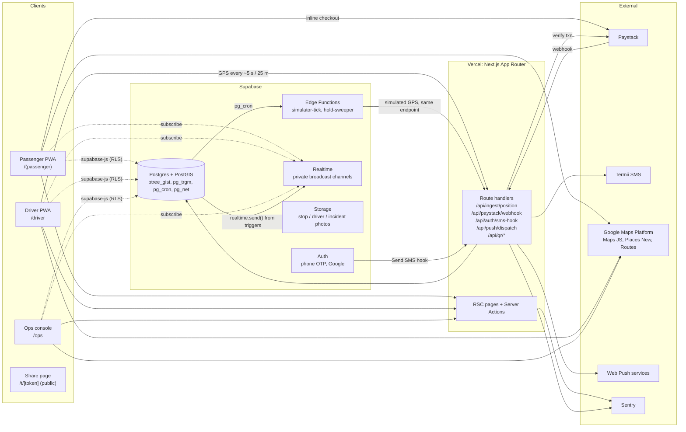
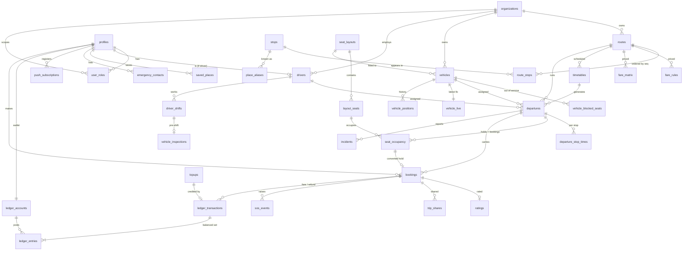
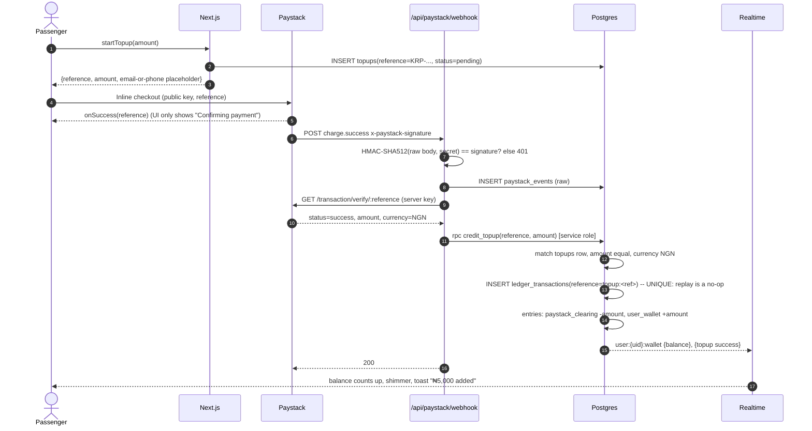

# Korope web v1: Architecture

Status: draft for review (2026-10-27). Nothing below is built yet.

Sources: `docs/korope-bible.md` (Vol I ch. 3–4, Vol II, Vol III, Vol IV ch. 4) and the Claude Design handoff in `korope docs/` (`korope-tokens.css/json`, `tailwind.korope.js`, `map-style-*.json`, `map-overlays.json`, component inventory and motion boards inside `Korope Design System v1.html`).

---

## 1. System overview



Principles:

1. **Business rules live in Postgres functions** (`public.*` RPCs for callers with a user JWT, `private.*` for service-only). Route handlers and Server Actions validate input with Zod, call one RPC, and shape the response. React components never compute fares, availability, balances or refund amounts. A future Expo app calls the same RPCs and route handlers.
2. **One ingestion path for positions.** Driver phones and the simulator both `POST /api/ingest/position`. Whether a vehicle is simulated is a column (`vehicles.simulated`), not a code branch.
3. **Concurrency is enforced by constraints**, not by app checks: an exclusion constraint on seat occupancy, a unique reference on ledger transactions, a non-negative balance check on wallet accounts, and row locks inside RPCs.
4. **Every table has RLS enabled.** Service role is used only in route handlers that need it (webhooks, ingestion, push dispatch) and never ships to the browser.

---

## 2. Application layout

```
src/
  app/
    (passenger)/          # mobile-first PWA, "/" root
      (tabs)/             # Home, Trips, Korope+, Wallet, Profile with bottom nav
      onboarding/ sign-in/ search/ departures/[id]/ seat/ confirm/
      trip/[bookingId]/   # waiting, boarding pass, live trip, arrival
    driver/               # driver PWA (own layout, own manifest scope)
    ops/                  # ops console, laptop-first
    t/[token]/            # public share-trip page (no auth)
    legal/ privacy/ terms/
    api/                  # route handlers listed above
    not-found.tsx
  components/
    ui/                   # Button, IconButton, Input, OtpInput, Chip, Badge, Toast, Banner, Skeleton, EmptyState
    mobility/             # CardDeparture, SeatMap, HoldTimer, CardFare, CardWallet, CardActiveTrip,
                          # CardBoardingPass, TimelineRoute, CardStop, CardDriver, PanelEmergency, CardNotification
    map/                  # MapStage, markers, polylines (lazy, client only)
    sheet/                # BottomSheet (vaul) with peek / half / full
  lib/
    contracts/            # Zod schemas shared by Server Actions, route handlers and (later) Expo
    money.ts              # formatNaira(kobo) — the only money formatter
    time.ts               # Africa/Lagos formatting
    supabase/             # server, browser and service clients
    realtime/             # per-screen channel hooks with cleanup
    qr/                   # sign / verify
  styles/tokens.css       # copied verbatim from the design handoff
supabase/
  migrations/  seed/  functions/  tests/   # pgTAP tests run by `supabase test db`
```

Surfaces are separated by layout and by `middleware.ts`, which reads the user's role and redirects: `/driver/**` needs `driver`, `/ops/**` needs `ops_admin`. Each surface has its own root layout so ops and driver code never enters the passenger bundle. The middleware is only routing; RLS is the real gate.

---

## 3. Data model

### 3.1 ERD



### 3.2 Tables

All ids are `uuid default gen_random_uuid()` unless noted. All timestamps are `timestamptz`. Money is `bigint` kobo. Every operational table carries `organization_id` (default: the single "Korope Public" organization) so Korope+ corporate and School fleets can be added later without reshaping data.

**Identity and roles**

| Table | Key columns | Notes |
|---|---|---|
| `organizations` | `id, name, kind ('public','corporate','school')` | One row in v1. |
| `profiles` | `id = auth.users.id, full_name, phone, avatar_path, onboarded_at, theme_pref` | Created by trigger on `auth.users` insert. |
| `user_roles` | `user_id, role ('passenger','driver','ops_admin'), organization_id` | PK `(user_id, role, organization_id)`. Everyone gets `passenger`. |
| `drivers` | `id, user_id (nullable until first login), organization_id, phone, full_name, photo_path, license_no, license_expires_on, languages text[], status` | Ops pre-registers by phone; a trigger links `user_id` and grants `driver` on first OTP sign-in with that phone. |

**Network**

| Table | Key columns | Notes |
|---|---|---|
| `stops` | `id, name, landmark, location geography(Point,4326), is_lit, is_sheltered, accessibility_note, photo_path, active` | GiST index on `location`. |
| `place_aliases` | `id, alias, alias_norm, stop_id null, google_place_id null, location null, weight` | `pg_trgm` GIN on `alias_norm`. "Chevron" resolves to Chevron Roundabout. |
| `routes` | `id, organization_id, code, name, path geography(LineString), encoded_polyline, active` | Path comes from Routes API on save in ops. |
| `route_stops` | `route_id, seq smallint, stop_id, distance_m, baseline_offset_s, dwell_s` | PK `(route_id, seq)`. `seq` starts at 0. Offsets are the baseline ETA from the Routes API. |
| `fare_rules` | `route_id, mode ('segment','matrix'), base_kobo, per_segment_kobo, effective_from` | Default pricing. |
| `fare_matrix` | `route_id, from_seq, to_seq, amount_kobo, effective_from` | Overrides `segment` mode when present. |

**Fleet and schedule**

| Table | Key columns | Notes |
|---|---|---|
| `seat_layouts` | `id, name, rows, cols, capacity` | 14, 16 and 18 seat layouts per the inventory. |
| `layout_seats` | `id, layout_id, label ('3A'), row, col, attrs text[] ('window','aisle','front','near_exit','priority','accessible')` | The `seat_id` everywhere else. |
| `vehicles` | `id, organization_id, fleet_no ('Bus 18'), plate, make_model, layout_id, simulated bool, status` | Flip `simulated` to go live. |
| `vehicle_blocked_seats` | `vehicle_id, seat_id, reason` | "Out of service" seats. |
| `timetables` | `id, route_id, days smallint[] (ISO 1–7), depart_local time, vehicle_id, driver_id, valid_from, valid_to` | Source of truth for recurring service. |
| `departures` | `id, organization_id, route_id, timetable_id, service_date, scheduled_at, vehicle_id, driver_id, status, current_seq, delay_s, sim_offset_s` | Status: `scheduled, boarding, in_progress, completed, cancelled`. Unique `(timetable_id, service_date)` keeps generation idempotent. |
| `departure_stop_times` | `departure_id, seq, scheduled_at, estimated_at, eta_confidence ('high','moderate','low'), arrived_at, departed_at` | ETAs written by ingestion. |

**Seats, bookings, holds**

| Table | Key columns | Notes |
|---|---|---|
| `seat_occupancy` | `id, departure_id, seat_id, segment int4range, kind ('hold','booking'), status ('active','released','expired'), user_id, fare_kobo, fare_breakdown jsonb, expires_at, booking_id` | Holds and bookings share one table so a single exclusion constraint covers both (see 3.3). |
| `bookings` | `id, organization_id, user_id, departure_id, seat_id, board_seq, alight_seq, occupancy_id, fare_kobo, fare_breakdown jsonb, status, qr_version int, boarded_at, cancelled_at, cancel_reason, refund_kobo` | Status: `confirmed, boarded, completed, cancelled, no_show`. |
| `ratings` | `booking_id PK, score smallint null, tags text[], comment` | Tags first, per Vol III ch. 3. |
| `trip_shares` | `id, booking_id, token_hash, expires_at, revoked_at` | Raw token only in the share URL. |
| `sos_events` | `id, booking_id, user_id, location, created_at, sms_sent_count` | |
| `emergency_contacts` | `id, user_id, name, phone, notify_on_share bool` | Max 5. |
| `saved_places` | `id, user_id, label, icon (Lucide name), location, google_place_id, stop_id` | |

**Wallet (double-entry ledger)**

| Table | Key columns | Notes |
|---|---|---|
| `ledger_accounts` | `id, kind ('user_wallet','paystack_clearing','fare_revenue','promo_expense'), user_id null, balance_kobo bigint, currency 'NGN'` | `balance_kobo` is a cache maintained by trigger and checked by a reconcile job. `CHECK (kind <> 'user_wallet' OR balance_kobo >= 0)`. |
| `ledger_transactions` | `id, kind ('topup','fare','refund','adjustment'), reference text UNIQUE, booking_id, topup_id, memo, created_by, created_at` | `reference` is the idempotency key (`topup:<paystack_ref>`, `fare:<booking_id>`, `refund:<booking_id>`). |
| `ledger_entries` | `id, transaction_id, account_id, amount_kobo bigint (signed, non-zero)` | Insert-only. Deferred constraint trigger asserts each transaction sums to 0. |
| `topups` | `id, user_id, reference UNIQUE, amount_kobo, status ('pending','success','failed','abandoned'), paystack_id, channel, verified_at` | Created before checkout opens. |
| `paystack_events` | `id, event, reference, signature_ok, payload jsonb, received_at, processed_at, error` | Raw audit of every webhook. |

**Live operations**

| Table | Key columns | Notes |
|---|---|---|
| `vehicle_positions` | `id bigint identity, vehicle_id, departure_id, recorded_at, location geography(Point), speed_mps, heading, accuracy_m, source ('device','simulator')` | Partitioned by day (pg_partman later); 30-day retention. |
| `vehicle_live` | `vehicle_id PK, departure_id, location, heading, speed_mps, progress_m, recorded_at, simulated` | Upserted per fix; what maps read. |
| `driver_shifts` | `id, driver_id, vehicle_id, started_at, ended_at, summary jsonb` | |
| `vehicle_inspections` | `id, shift_id, items jsonb, result ('pass','attention','fail'), photo_paths text[]` | |
| `incidents` | `id, departure_id, vehicle_id, reported_by, category, description, photo_paths, status, created_at` | |
| `simulator_state` | singleton: `running bool, speed_multiplier numeric, updated_by` | Plus `departures.sim_offset_s` for injected delays. |

**Platform**

| Table | Notes |
|---|---|
| `push_subscriptions` | `user_id, endpoint UNIQUE, p256dh, auth, user_agent, created_at` |
| `notification_prefs` | `user_id PK, trip_updates, bus_approaching, marketing (false)` |
| `notification_outbox` | `id, user_id, kind, payload jsonb, dedupe_key UNIQUE, send_after, sent_at, error` — dedupe stops repeat "2 stops away" pushes. |
| `korope_plus_leads` | `id, user_id null, name, phone, email, company, route_interest, created_at` |
| `audit_log` | `id, actor_id, action, entity, entity_id, before jsonb, after jsonb, at` — written by triggers on ops-editable tables. |
| `rate_limits` | `key, window_start, count` — used by `private.rate_limit(key, max, window)`. |

### 3.3 The constraints that matter

```sql
create extension if not exists btree_gist;

-- A seat on a departure can be occupied by at most one active hold or booking per stop segment.
-- segment = int4range(board_seq, alight_seq, '[)'), so a 2->5 booking frees the seat from stop 5 on.
alter table seat_occupancy
  add constraint seat_occupancy_no_overlap
  exclude using gist (departure_id with =, seat_id with =, segment with &&)
  where (status = 'active');

alter table seat_occupancy
  add constraint segment_valid check (lower(segment) >= 0 and upper(segment) > lower(segment));

-- Ledger: wallets cannot go negative; every transaction balances.
alter table ledger_accounts
  add constraint wallet_non_negative check (kind <> 'user_wallet' or balance_kobo >= 0);

create constraint trigger ledger_txn_balanced
  after insert on ledger_entries deferrable initially deferred
  for each row execute function private.assert_txn_balanced();
```

Expired holds and the constraint: an exclusion constraint cannot reference `now()`, so an expired-but-unswept hold still blocks the seat at the constraint level. `create_hold` therefore first marks expired holds on that `(departure_id, seat_id)` as `expired` inside the same transaction, then inserts. Availability queries filter `expires_at > now()` regardless. The sweeper (pg_cron, every 30 s) is housekeeping and realtime cleanup, not a correctness requirement.

### 3.4 Core functions (RPC surface)

| Function | Caller | What it does |
|---|---|---|
| `search_departures(origin, dest, after, limit 3)` | passenger | Finds stops within walking radius (800 m, widening to 1.5 km) of origin and destination on the same route with `board_seq < alight_seq`, upcoming departures, seats free for that segment, fare, ETA to boarding stop. Scores and returns up to 3 with a `reason`. |
| `quote_fare(departure_id, board_seq, alight_seq)` | any | Returns `{lines:[{code,label,amount_kobo}], adjustment_kobo: null, total_kobo}`. |
| `seat_map(departure_id, board_seq, alight_seq)` | passenger | Every seat with state `available / held / reserved / unavailable / mine` for that segment. No other user ids leak. |
| `create_hold(departure_id, seat_id, board_seq, alight_seq)` | passenger | Rate-limited. Releases the caller's other active holds, sweeps expired holds on that seat, locks the fare, inserts with `expires_at = now() + 5 min`. Exclusion violation becomes `SEAT_TAKEN`. |
| `release_hold(hold_id)` | passenger | Owner only. |
| `confirm_booking(hold_id)` | passenger | One transaction: lock hold (must be active, unexpired, owned), lock wallet row, check balance, post `fare` ledger txn, insert booking, convert occupancy to `booking`. Returns booking or `INSUFFICIENT_FUNDS` with shortfall. |
| `cancel_booking(booking_id, reason)` | passenger, ops | Applies refund policy (see DECISIONS), posts `refund` txn, releases occupancy. |
| `issue_boarding_token(booking_id)` | passenger (route handler) | Bumps `qr_version`, returns signed token. |
| `validate_boarding(token_claims, departure_id)` | driver (route handler verifies signature first) | Returns `valid / already_boarded / wrong_departure / expired / cancelled`, marks boarded. |
| `ingest_positions(batch)` | service (route handler) | Insert history, upsert `vehicle_live`, snap to route with `ST_LineLocatePoint`, advance `current_seq`, write ETAs, enqueue pushes, broadcast. |
| `generate_departures(from_date, to_date)` | ops, cron nightly | Idempotent upsert from timetables. |
| `credit_topup(reference, amount_kobo, paystack_payload)` | service only | Idempotent on `topup:<reference>`. |
| `wallet_reconcile()` | cron hourly | Compares cached balances with `sum(entries)`; writes to `audit_log` and Sentry on mismatch. |

Departure recommendation score (lower is better, all in minutes):
`score = arrival_at_destination_min + 0.5 × wait_at_stop_min + 0.3 × walk_min + (seats_left ≤ 2 ? 5 : 0)`.
Reasons, first that applies: "Gets you there first", "Leaves soonest", "Most seats free", "Shortest walk".

---

## 4. Realtime

Supabase Realtime **Broadcast from the database** on private channels, authorised by RLS on `realtime.messages`. Triggers call `realtime.send(payload, event, topic, true)`. We avoid `postgres_changes` for shared data because it would expose other passengers' rows.

| Topic | Event(s) | Payload | Who may join | Subscribed on |
|---|---|---|---|---|
| `departure:{id}:seats` | `seat` | `{seat_id, segment:[from,to], state, expires_at}` where state is held, reserved or free | any authenticated user | Seat map screen only |
| `departure:{id}:live` | `position`, `eta`, `status` | `{lat,lng,heading,speed,progress_m,current_seq}` / `{seq, eta, confidence}` / `{status, delay_s}` | holders of an active booking on that departure, its assigned driver, ops | Waiting, live trip, driver home |
| `booking:{id}` | `status` | `{status, boarded_at}` | booking owner, ops | Booking confirmed, pass, live trip |
| `user:{uid}:wallet` | `balance`, `topup` | `{balance_kobo}` / `{reference, status}` | that user | Wallet, top-up sheet |
| `ops:fleet` | `position`, `departure`, `incident` | compact | `ops_admin` | Ops live map, departures board |
| `driver:{driver_id}` | `manifest` | `{booking_id, seat, status}` | that driver, ops | Driver home, manifest |

Home's "nearby buses" uses a 15 s polled RPC (`nearby_vehicles(point, radius)`) rather than a broad subscription, to protect data on 3G. The public share page polls `/api/share/[token]` every 10 s; no realtime credentials go to anonymous users.

Every hook in `lib/realtime` subscribes in `useEffect` and calls `supabase.removeChannel` on unmount.

---

## 5. Sequences

### 5.1 Seat hold

```mermaid
sequenceDiagram
  autonumber
  actor A as Passenger A
  actor B as Passenger B
  participant N as Next.js (Server Action)
  participant DB as Postgres
  participant RT as Realtime

  A->>N: selectSeat(dep, seat 3A, board 1, alight 6)
  N->>DB: rpc create_hold(...)
  DB->>DB: release A's other holds; expire stale holds on 3A
  DB->>DB: quote_fare() -> lock fare into hold
  DB->>DB: INSERT seat_occupancy [1,6) status=active, expires now()+5m
  DB-->>RT: broadcast departure:dep:seats {3A, [1,6), held}
  DB-->>N: hold {id, fare, breakdown, expires_at}
  N-->>A: show HoldTimer + CardFare
  RT-->>B: 3A shows "Being reserved" for stops 1–6

  B->>N: selectSeat(dep, 3A, board 3, alight 8)
  N->>DB: rpc create_hold(...)
  DB--xN: exclusion_violation (overlaps [1,6))
  N-->>B: SEAT_TAKEN: "Someone is reserving that seat. Pick another one." (nothing charged)

  Note over DB: pg_cron every 30 s: UPDATE ... SET status='expired' WHERE expires_at < now()<br/>trigger broadcasts {3A, free}
```

### 5.2 Confirm and pay

```mermaid
sequenceDiagram
  autonumber
  actor P as Passenger
  participant N as Next.js
  participant DB as Postgres
  participant RT as Realtime

  P->>N: confirmBooking(hold_id)
  N->>DB: rpc confirm_booking(hold_id)
  activate DB
  DB->>DB: SELECT hold FOR UPDATE (active, owner, expires_at > now())
  DB->>DB: SELECT wallet account FOR UPDATE
  alt balance < fare
    DB-->>N: INSUFFICIENT_FUNDS {shortfall_kobo}
    N-->>P: inline top-up sheet, hold timer keeps running
  else balance ok
    DB->>DB: INSERT ledger_transactions(kind=fare, reference=fare:<booking_id>)
    DB->>DB: INSERT ledger_entries (wallet -fare, fare_revenue +fare)
    DB->>DB: INSERT bookings(status=confirmed)
    DB->>DB: UPDATE seat_occupancy SET kind=booking, expires_at=null
    DB->>DB: COMMIT (deferred balance check passes)
    DB-->>RT: seats {3A reserved}; user wallet {balance}
    DB-->>N: booking
    N-->>P: 600 ms confirm sequence -> Journey card
  end
  deactivate DB
```

If the hold expired before confirm: `HOLD_EXPIRED`, copy "Your seat hold ran out. Nothing has been charged." and the seat map reopens.

### 5.3 Wallet top-up (Paystack)



A reconcile job lists Paystack transactions for the last 24 h and re-runs `credit_topup` for any `success` without a ledger row (covers missed webhooks). `pending` topups older than 1 h become `abandoned`.

### 5.4 Position ingestion (driver and simulator)

```mermaid
sequenceDiagram
  autonumber
  participant D as Driver PWA (watchPosition + Wake Lock)
  participant S as simulator-tick (Edge Fn, pg_cron 5 s)
  participant I as /api/ingest/position
  participant DB as Postgres
  participant RT as Realtime
  participant Q as notification_outbox -> /api/push/dispatch

  D->>I: POST [{vehicle_id, departure_id, lat, lng, heading, speed, accuracy, ts}] (driver JWT)
  S->>I: POST same shape, batch (simulator service token)
  I->>I: Zod validate; authorise (driver assigned to departure, or simulator token AND vehicle.simulated)
  I->>DB: rpc ingest_positions(batch)
  DB->>DB: insert vehicle_positions; upsert vehicle_live
  DB->>DB: progress = ST_LineLocatePoint(route.path, fix) * length
  DB->>DB: advance current_seq, set arrived_at/departed_at, recompute ETAs
  DB->>Q: enqueue "2 stops away", "arriving", "next stop is yours" (dedupe_key)
  DB-->>RT: departure:{id}:live position/eta; ops:fleet position
  Q-->>Q: web-push to subscriptions (VAPID)
```

The simulator never writes to the database directly; it only knows the HTTP contract. A real driver posting for a vehicle with `simulated = true` is rejected, and so is the simulator posting for a real vehicle, so the two can never fight over one bus.

### 5.5 Boarding

```mermaid
sequenceDiagram
  autonumber
  actor P as Passenger
  actor Dr as Driver
  participant N as Next.js
  participant DB as Postgres

  P->>N: open boarding pass (online)
  N->>DB: issue_boarding_token -> qr_version++
  N-->>P: token = base64url({b,d,s,v,exp}).HMAC ; cached by service worker
  Dr->>Dr: BarcodeDetector (fallback: zxing-wasm) reads token
  Dr->>N: POST /api/qr/validate {token, departure_id}
  N->>N: verify HMAC + exp
  N->>DB: rpc validate_boarding(claims, departure_id)
  DB-->>N: valid | already_boarded | wrong_departure | expired | cancelled
  N-->>Dr: full-screen result + haptic
  DB-->>P: booking:{id} status=boarded -> pass morphs to "Boarded"
```

Token expiry is the scheduled arrival at the passenger's alighting stop plus 2 hours, so a pass saved offline still works for the whole trip. Re-opening online rotates `qr_version`; only the latest version validates, which stops a screenshot being reused by someone else.

---

## 6. Row Level Security matrix

Legend: **R** read, **C** create, **U** update, **D** delete, **own** rows where `user_id = auth.uid()`, **asg** rows tied to a departure/vehicle the driver is assigned to today, **fn** only through a `security definer` function, **–** none. `service` = service role, bypasses RLS and is used only in the listed route handlers.

| Table | anon | passenger | driver | ops_admin |
|---|---|---|---|---|
| organizations | – | R | R | R U |
| profiles | – | R U own | R U own; R of passengers on asg manifest (name only, via view) | R U |
| user_roles | – | R own | R own | R C U D |
| drivers | – | R (public fields via `driver_public` view for asg bookings) | R U own (photo) | R C U D |
| stops, route_stops, routes, place_aliases | R (active) | R | R | R C U D |
| fare_rules, fare_matrix | – | R | R | R C U D |
| seat_layouts, layout_seats | – | R | R | R C U D |
| vehicles, vehicle_blocked_seats | – | R (public fields) | R asg | R C U D |
| timetables | – | – | R asg | R C U D |
| departures, departure_stop_times | – | R | R asg | R C U D |
| seat_occupancy | – | R own; others via `seat_map()` fn | – | R |
| bookings | – | R own; C U via fn | R asg (manifest view); U via `validate_boarding` / `mark_no_show` fn | R; U via `cancel_booking` fn |
| ratings | – | C R own | R asg (aggregate only) | R |
| trip_shares | – (share route uses service role with token hash) | C R U own | – | R |
| sos_events | – | C R own | – | R U |
| emergency_contacts, saved_places | – | R C U D own | – | R |
| ledger_accounts | – | R own | – | R |
| ledger_transactions, ledger_entries | – | R own (via own account) | – | R; C via `post_adjustment` fn |
| topups | – | R own; C via `start_topup` fn | – | R |
| paystack_events | – | – | – | R |
| vehicle_positions | – | – | C via ingestion | R |
| vehicle_live | – | R (vehicle_id, location, heading only, for active departures) | R | R |
| driver_shifts, vehicle_inspections | – | – | R C U own | R |
| incidents | – | – | C R own | R U |
| simulator_state | – | – | – | R U |
| push_subscriptions, notification_prefs | – | R C U D own | R C U D own | R |
| notification_outbox | – | – | – | R |
| korope_plus_leads | – | C (only `insert`, no read-back) | – | R |
| audit_log | – | – | – | R |
| rate_limits | – | – | – | – |
| realtime.messages | – | join topics per §4 | join topics per §4 | join all |

Helpers (`security definer`, `stable`, `search_path = ''`): `private.has_role(role)`, `private.is_assigned_driver(departure_id)`, `private.owns_booking(booking_id)`. Policies call these instead of reading JWT claims, so a role change takes effect immediately. A custom access token hook still adds `roles` to the JWT so middleware can route without a DB call.

Every policy is covered by pgTAP tests that `set local role authenticated` with a forged `request.jwt.claims` for each persona and assert both allowed and denied cases.

---

## 7. Auth

- **Phone OTP (primary).** Supabase phone provider with the **Send SMS hook** pointed at `POST /api/auth/sms-hook`. The handler verifies the Standard Webhooks signature (`SEND_SMS_HOOK_SECRET`), rate-limits per phone and per IP, and calls Termii's SMS API with the approved sender ID (DND route, since many Lagos numbers are on DND). If Termii fails the hook returns an error so Supabase reports a failure instead of a silent success. OTP length 6, expiry 5 minutes.
- **Google (secondary).** After a Google sign-in without a phone, the user is asked to add and verify a phone number before booking, because SOS, driver contact and receipts depend on it.
- **Drivers.** Ops pre-registers drivers by phone. The `/driver` sign-in only sends an OTP if the phone matches an active `drivers` row (checked through `private.can_driver_sign_in(phone)`). The link trigger grants the `driver` role on first sign-in.
- **Ops.** `ops_admin` is granted manually (SQL or by another ops admin). Ops sign in with phone OTP or Google.

---

## 8. Maps

- Maps JS API loaded with `@googlemaps/js-api-loader` **after first paint**, behind a CSS skeleton. Vector map with a **Map ID** per theme (light and night). Cloud-based styling is configured in Google Cloud Console from `map-style-light.json` / `map-style-night.json`; the JSON files are kept in the repo for reference and for raster fallback. Night style applies 18:30 to 06:00 Lagos time or when the system theme is dark.
- Advanced Markers for buses (`--bus-marker`, my bus ring `--bus-marker-ring`), stops and the user. Overlay colours come from the CSS tokens at runtime (`getComputedStyle`), never hardcoded hex; `map-overlays.json` documents the expected values.
- **Places API (New)** Autocomplete via a server route (`/api/places/autocomplete`) with session tokens, `includedRegionCodes: ['ng']`, location bias to the Lagos bounding box. Results are merged with a local `search_places(q)` RPC over `stops` + `place_aliases` (trigram), Korope stops ranked first.
- **Routes API** is server-side only: used by ops when saving a route (polyline + baseline per-stop offsets) and nightly to refresh baselines per time band. Not called per passenger request.
- Walking: deep link `https://www.google.com/maps/dir/?api=1&destination=lat,lng&travelmode=walking`.
- Keys: `NEXT_PUBLIC_GOOGLE_MAPS_BROWSER_KEY` restricted by HTTP referrer to our domains and to Maps JS only. `GOOGLE_MAPS_SERVER_KEY` (Places, Routes) is restricted by API and never sent to the client.

---

## 9. PWA, offline and push

- Serwist service worker. Precache the app shell, fonts and icons. Runtime cache: `StaleWhileRevalidate` for static RPC reads (stops, routes), `NetworkOnly` for mutations.
- **Offline boarding pass**: when the pass is rendered online, the client stores `{token, booking summary, savedAt}` in IndexedDB and the SW caches `/trip/[id]/pass`. Offline, the pass renders from IndexedDB with "Saved {time}. Shown offline." (`CardBoardingPass` offline variant).
- Offline banner from `navigator.onLine` plus failed-fetch detection.
- **Web Push** with VAPID. Prompt only in context (after the first booking: "Never miss your bus"). On iOS Safari outside standalone mode we show the add-to-home-screen explainer instead, because iOS only delivers web push to installed PWAs.
- Driver PWA: `watchPosition` (high accuracy) + Screen Wake Lock while a shift is active, posting when 5 s have passed **and** the bus moved 25 m, or every 30 s regardless (heartbeat). A persistent banner tells the driver the screen must stay on and the app in front. Wake lock is re-acquired on `visibilitychange`.

---

## 10. Simulator

`simulator-tick` Edge Function, invoked every 5 s by Supabase Cron while `simulator_state.running`:

1. Load active departures whose vehicle is `simulated = true` and whose scheduled window covers now (± 15 min).
2. Simulated clock per departure: `t = (now - scheduled_at) × speed_multiplier - sim_offset_s`.
3. Walk the route stop by stop: travel time per leg = `baseline_leg_s × traffic_factor(leg, local_time) × noise`, then `dwell_s` at each stop (base 30–90 s, longer at Chevron, Lekki toll gate, CMS at peak). `traffic_factor` uses a Lekki–VI peak profile (e.g. 1.6–2.2× on Lekki–Epe 06:30–09:30 and 16:30–20:00). Noise is a seeded random walk per departure so a bus is consistently late rather than jittering.
4. Interpolate position along `routes.path` at the resulting distance, add 3–8 m GPS jitter, compute heading.
5. POST the batch to `/api/ingest/position` with the simulator token.

Ops controls: start/stop, speed multiplier (1×, 2×, 5×, 10×), "inject delay" (+N min on a departure, which adds to `sim_offset_s`).

---

## 11. Observability, security, performance

- Sentry in browser, server and edge runtimes; PII scrubbing for phone numbers and tokens.
- Rate limits (Postgres `private.rate_limit`): OTP send 3 per phone per 10 min and 10 per IP per hour; `create_hold` 20 per user per 10 min; `confirm_booking` 10 per user per 10 min; top-up start 10 per user per hour.
- CSP with nonces; Paystack, Google Maps and Supabase origins allowed explicitly.
- Performance budget: passenger home ≤ 170 KB gzipped initial JS excluding the Maps SDK, enforced in CI with `size-limit` against the built route chunks. No Framer Motion on the home route.
- Data retention (privacy policy must match): positions 30 days, OTP/SMS logs 90 days, ledger and bookings 6 years (financial records), SOS events 2 years, Paystack raw events 6 years.

---

## 12. Environment variables

See `.env.example` (created in M0). Public: `NEXT_PUBLIC_SUPABASE_URL`, `NEXT_PUBLIC_SUPABASE_ANON_KEY`, `NEXT_PUBLIC_GOOGLE_MAPS_BROWSER_KEY`, `NEXT_PUBLIC_MAP_ID_LIGHT`, `NEXT_PUBLIC_MAP_ID_NIGHT`, `NEXT_PUBLIC_PAYSTACK_PUBLIC_KEY`, `NEXT_PUBLIC_VAPID_PUBLIC_KEY`, `NEXT_PUBLIC_SENTRY_DSN`. Server only: `SUPABASE_SERVICE_ROLE_KEY`, `SEND_SMS_HOOK_SECRET`, `TERMII_API_KEY`, `TERMII_SENDER_ID`, `PAYSTACK_SECRET_KEY`, `GOOGLE_MAPS_SERVER_KEY`, `QR_SIGNING_SECRET`, `SIMULATOR_TOKEN`, `VAPID_PRIVATE_KEY`, `VAPID_SUBJECT`, `SENTRY_AUTH_TOKEN`, `CRON_SECRET`.
